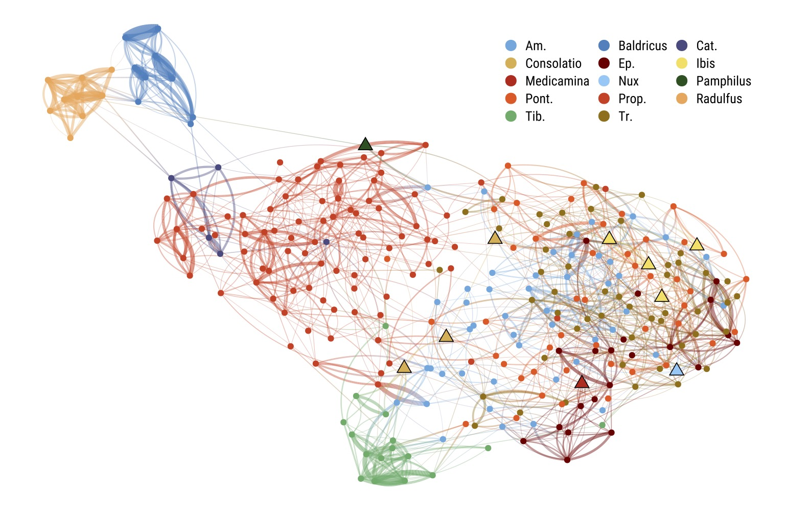
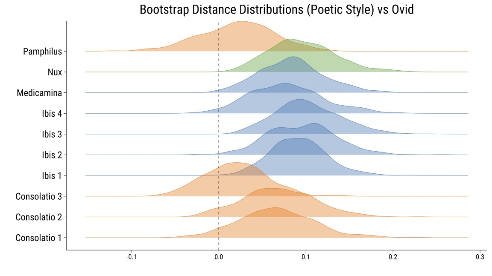

# nux-paper [](https://creativecommons.org/licenses/by/4.0/) [](https://doi.org/10.5281/zenodo.8355505) [](https://doi.org/10.1353/hel.2025.a984782)

# A Stylometric Reassessment of the (Pseudo?) Ovidian _Nux_

Technical reproduction materials for our paper.

## ABSTRACT

The _Nux_ (or _De nuce_, ‘On the Walnut Tree’), has been described as ‘the most accomplished of pseudo-Ovidian poems’ (Tarrant in Reynolds 1983: 286). Its disputed authorship provokes anxiety. It is too good, scholars feel and felt, to be anonymous or pseudepigraphal, and it was considered a canonically and genuinely Ovidian poem until the 18th century, with no less a scholar than Erasmus favouring it with a full commentary. Today, it is generally considered a pseudo-Ovid, despite these desires and anxieties. Recent scholarship suggests that the debate is closed—the _Nux_ is included in the 2020 edition of medieval pseudo-Ovidiana, for instance—but this is based more on the lack of conclusive authentication than on positive evidence.

Using stylometric analysis, this paper reassesses the authorship and dating of the _Nux_. Stylometric analysis strongly suggests Ovidian authorship (from Ovid’s exilic period), or an imitator with an astoundingly innate sense for Ovidian composition. Or, perhaps, a mixture of the two, given the condition of the earliest surviving witnesses (from c. 1100), which contain medieval interpolations as well as potentially ancient poetry. ‘Genuine’, in the case of the _Nux_, cannot be considered a binary condition, and the poem therefore has much to tell us about how to approach literature of contested authenticity.

## TLDR

The _Nux_ is highly Ovidian, particuarly in its poetic (metrical, etc) style. Moreover, it is consistent with late Ovidian metrics more so than early, which is consistent with its presumed exilic composition. The _Medicamina_, another poem that has been questioned, is correctly identified as more consistent with earlier style. For comparison, we included the _Consolatio ad Liviam_ in our analysis, which is now accepted to be (Late Antique?) imitatio, but was accepted during the medieval period. The methods are able to distinguish between good imitatio and Ovid. This does not rule out the (faint) possibility that the _Nux_ is simply better imitatio, but such proofs are unobtainable.

### Cluster Analysis (poetic features)


### Bootstrap Distance Imposters (poetic features)



## Citation

```bibtex
@article{menmuir2025nux,
  author  = {Menmuir, Rebecca and Nagy, Benjamin},
  title   = {A Stylometric Reassessment of the (Pseudo?) Ovidian \textit{Nux}},
  journal = {Helios},
  volume  = {52},
  number  = {1},
  pages   = {47--83},
  year    = {2025},
  doi     = {10.1353/hel.2025.a984782}
}
```

## Reproducing the figures

The environment is pinned. The Python versions are the ones recorded in the
notebooks' `%watermark` cells from the paper run (20 January 2025) and are
enforced by `pyproject.toml`; the R versions are printed by the `%%R`
session-info cell at the end of each notebook.

**Python.** Install with 3.12: the pins in `pyproject.toml` are the versions from
the paper run, and pandas 2.2.2 and numpy 1.26.4 predate the 3.13 wheels. The
pins are not a scientific requirement — the notebooks reproduce on 3.14 with
current library versions too — but pinning keeps the outputs bit-for-bit
comparable with the published figures.

```bash
python3.12 -m venv .venv
source .venv/bin/activate
pip install "nux-paper[lab] @ git+https://github.com/bnagy/nux-paper@paper-figures"
```

**R.** The notebooks use `rpy2`, so an R installation (4.5.3 in the paper run)
must be on `PATH`, with these packages:

    ggplot2, ggraph, ggtext, tidygraph, igraph, showtext, ggsci, stringr,
    paletteer, dplyr, ggridges

`rpy2` compiles against whichever R it finds, so install it with that R
available.

**Running.** Start Jupyter from `repro/` and run the notebooks in this order:

| notebook | writes |
|---|---|
| `build_corpus.ipynb` | `elegy_corpus.csv`, `elegy_poetic.csv` |
| `bct_ngram.ipynb` | `figures/bct_ngram.pdf` |
| `bct_poet.ipynb` | `figures/bct_poet.pdf` |
| `nux_bdi_ngram.ipynb` | `figures/bdi_ngram.pdf`, `figures/bdi_ngram_bubble.pdf` |
| `nux_bdi_poet.ipynb` | `figures/bdi_poet.pdf` |

The derived vectors are committed, so `build_corpus.ipynb` is only needed to
rebuild them from `corpus/`.

The `ggsave` calls are commented out so that running a notebook does not
overwrite the figures; uncomment to regenerate. `figures/fig1.pdf`–`fig5.pdf`
are the figures of the published paper and are archival.

## LICENSE

CC-BY 4.0 (see LICENSE.txt)
